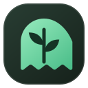
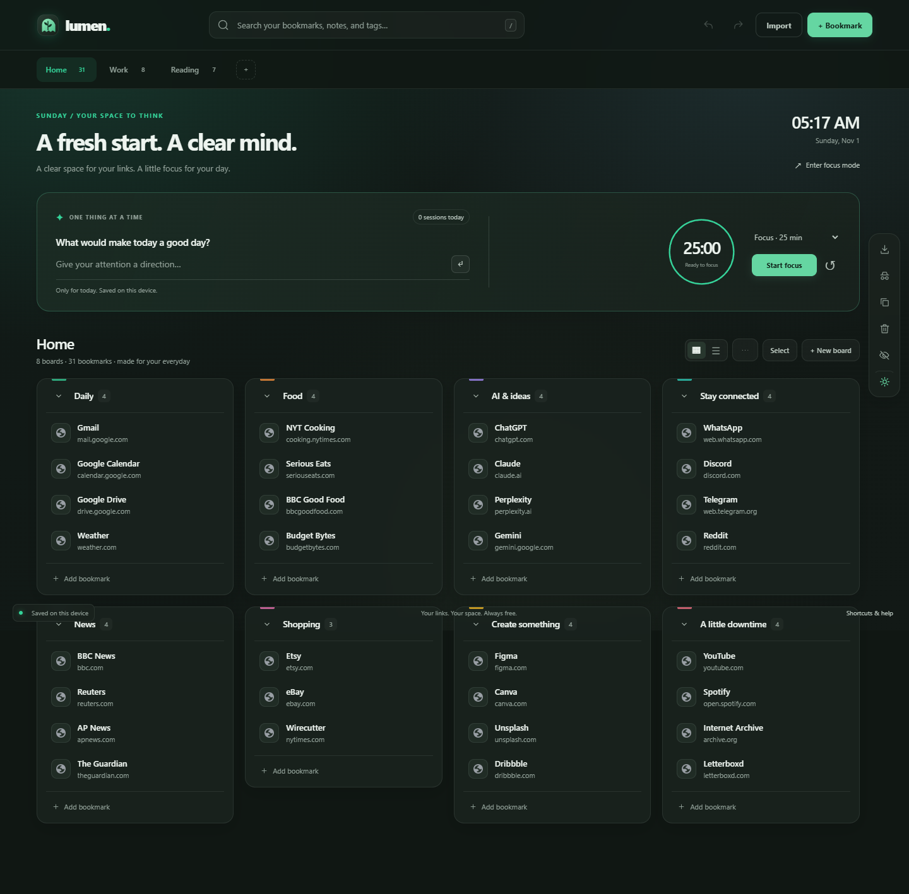
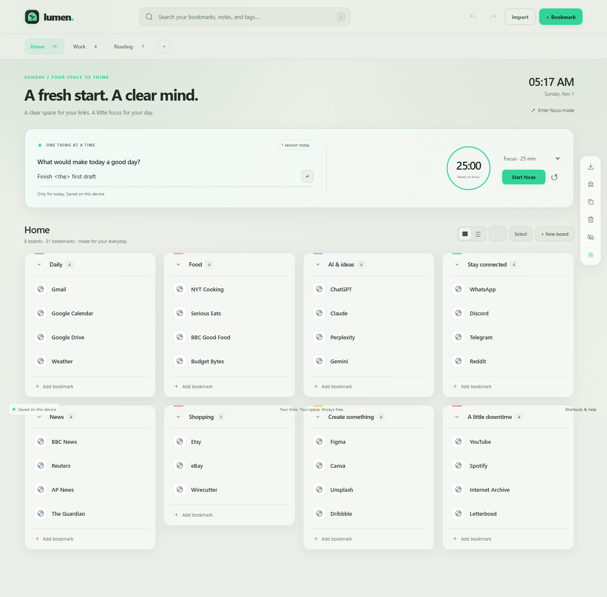
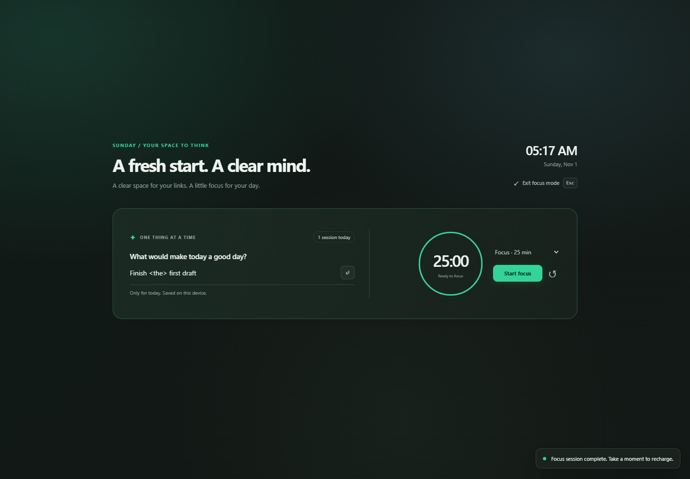
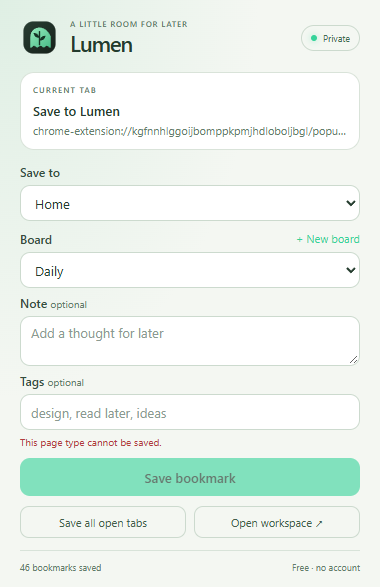
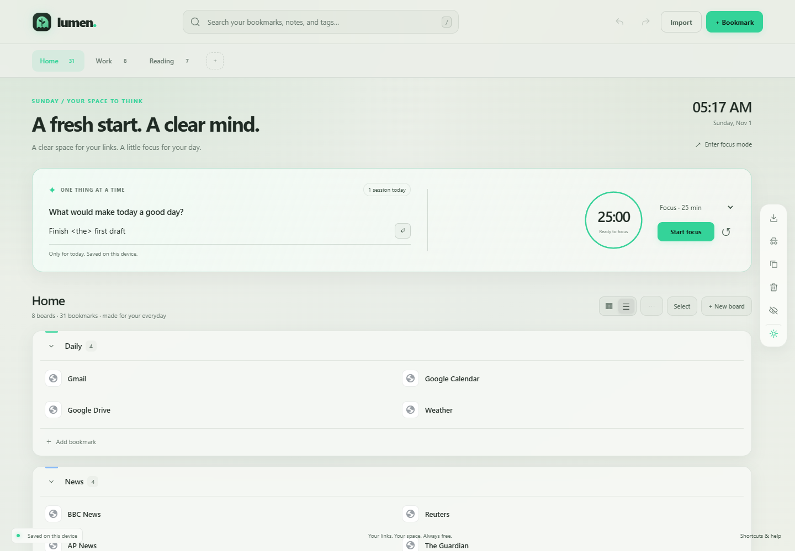
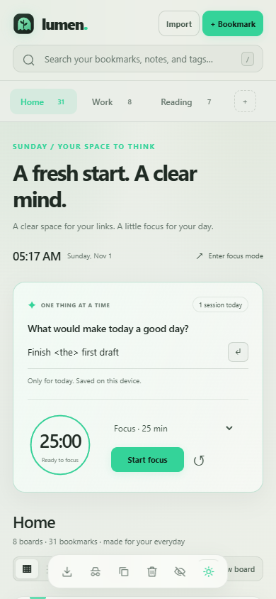

# Lumen — Free Bookmark Workspace

<p align="center">
  
</p>

<p align="center">
  <strong>A private, local-first Chrome extension for unlimited bookmarks.</strong><br>
  No account. No server. No subscription. No limits.
</p>

<p align="center">
  
  
  
</p>

---

## What is Lumen?

Lumen is a Chrome extension that replaces your new tab with a full bookmark workspace. Everything stays in your browser's local IndexedDB — no cloud, no telemetry, no collection limits. Your available space is limited only by your device and browser storage.

### ✨ Features

- **Unlimited pages, boards & bookmarks** — organize however you like
- **Quick save** — toolbar popup, context menu, or `Ctrl+Shift+Y`
- **Save all open tabs** in one click
- **Masonry board layout** with drag-and-drop reordering
- **Notes & tags** on every bookmark
- **Search** across all pages or the current page, with exact phrase matching
- **Bulk actions** — select, move, open, or trash multiple bookmarks
- **Duplicate detection** — find overlapping URLs
- **Trash & restore** — nothing is permanently deleted until you say so
- **Undo / redo** within a session
- **Themes** — dark, light, or system-following, with accent colors and wallpapers
- **Privacy blur** — hide bookmark content during screen sharing
- **Import & export** — JSON, HTML, CSV, TXT, pasted links, or Chrome bookmarks
- **LumiList 2.1.3 portability import** — migrate with page/board grouping preserved

### 🎯 New in v1.1 — Focus Mode

- Daily focus note, live clock/date, and session counter
- Focus/break timer with 25/50/90-minute presets and custom durations
- Distraction-free mode that hides bookmarks — press Escape to return
- Board/list layout toggle, adjustable card opacity, and focus-panel visibility
- Compact, theme-aware popup

---

## Screenshots

| Dark | Light | Focus Mode |
|:---:|:---:|:---:|
|  |  |  |

| Popup | List View | Mobile |
|:---:|:---:|:---:|
|  |  |  |

---

## Install

1. Download or clone this repository
2. Open `chrome://extensions` in Chrome
3. Enable **Developer mode**
4. Click **Load unpacked** and select the `lumen-free` folder
5. Open a new tab — Lumen is ready

> To update, pull the latest changes and click **Reload** on the extension card at `chrome://extensions`. Your data is preserved.

## Permissions

| Permission | Why |
|---|---|
| `storage` + `unlimitedStorage` | Local bookmark database |
| `activeTab` | Save the page you're viewing |
| `contextMenus` | Right-click "Save to Lumen" |
| `favicon` | Display site icons |
| `bookmarks` *(optional)* | Import from Chrome bookmarks |
| `tabs` *(optional)* | Save all open tabs |

Lumen has **no host permissions** and makes **no network requests**. Your data never leaves your device.

## Project Structure

```
lumen-free/           # Extension source (load this folder)
├── manifest.json     # Manifest V3 configuration
├── background.js     # Service worker: quick save, context menus
├── newtab.html        # Dashboard / new tab override
├── app.js            # Main workspace application
├── store.js          # Shared IndexedDB schema
├── popup.*           # Toolbar save popup
├── focus.js          # Focus timer & daily note
├── focus-state.js    # Persistent focus state
├── import-export.js  # Import/export engine
├── assets/           # Icons and branding
├── *.css             # Stylesheets
└── LICENSE           # MIT
checks/               # Automated test suite (Playwright + Node)
reports/              # Verification results & screenshots
```

## License

[MIT](lumen-free/LICENSE)
